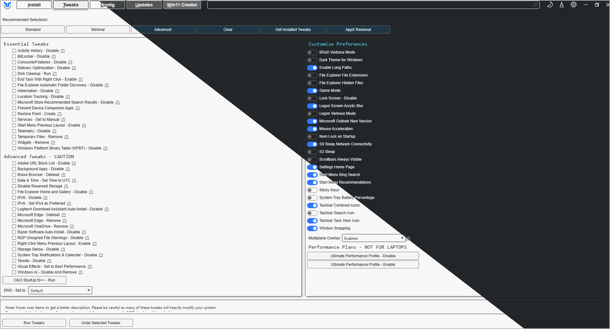
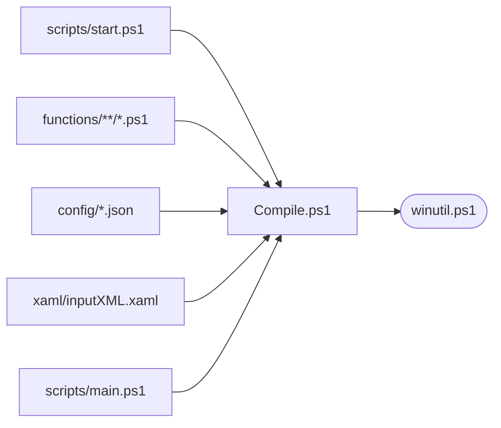

<div align="center">

# WinUtil Pro

**The all-in-one Windows 11 utility — debloat Windows, remove bloatware, harden privacy, install 325+ apps with WinGet, apply reversible tweaks, and build custom ISOs from a single PowerShell command, with verified downloads and an audited app catalog.**

[](LICENSE)
[](#requirements)
[](#requirements)
[](https://github.com/ChrisTitusTech/winutil)

[Quick start](#quick-start) · [Features](#features) · [What's different in Pro](#whats-different-in-pro) · [Development](#development) · [Roadmap](#roadmap) · [Credits](#credits-and-license)



</div>

---

## Overview

WinUtil Pro is a maintained fork of [Chris Titus Tech's Windows Utility](https://github.com/ChrisTitusTech/winutil), a PowerShell and WPF tool that installs software, applies reversible Windows tweaks, repairs common problems, manages Windows Update, and builds customized Windows 11 ISOs.

The fork keeps the upstream architecture and stays merge-compatible with it. Its focus is **safety and trust**:
- The tools WinUtil downloads and launches itself (O&O ShutUp10++, Sysinternals Autologon, the PowerShell MSI) are signature-checked before they run.
- Third-party data is validated before it touches the system.
- Catalog entries carry verified license data.

**Use WinUtil Pro to:**

- **Debloat Windows 11** — remove pre-installed bloatware and Store apps, disable telemetry, and reclaim resources.
- **Set up a new PC fast** — install 325+ applications in one pass through WinGet or Chocolatey, no browser hunting.
- **Build a developer environment** — full frontend and backend stacks: databases, cloud and Kubernetes CLIs, runtimes, and editors (see [Developer stacks](#developer-stacks)).
- **Harden privacy and security** — reversible tweaks plus a curated set of security, networking, red-team, and blue-team tools.
- **Create custom Windows 11 installation media** — build an unattended ISO from an official Microsoft image.

> [!IMPORTANT]
> WinUtil makes system-wide changes and must run as **Administrator**. Read what a tweak does before applying it, and create a restore point first (Tweaks → *Restore Point - Create*).

---

## Quick start

### Requirements

| | |
|---|---|
| **OS** | Windows 11 (Windows 10 is not supported; it reached end of support on October 14, 2025) |
| **Shell** | Windows PowerShell 5.1 (built in) or PowerShell 7 |
| **Rights** | Administrator |

### Run WinUtil Pro

Open PowerShell or Terminal **as Administrator** and run:

```powershell
irm 6t9xstar.github.io/win | iex
```

This downloads the [latest release](https://github.com/6t9xstar/winutil-pro/releases/latest) through a small [launcher](https://github.com/6t9xstar/win) and starts it. On an untrusted network, type the full `https://6t9xstar.github.io/win` so the first request is encrypted too.

<details>
<summary><b>Build from source instead</b></summary>

Requires [Git](https://git-scm.com/). `Compile.ps1` combines the source files into one `winutil.ps1`, and `-Run` launches it.

```powershell
git clone https://github.com/6t9xstar/winutil-pro.git
cd winutil-pro
Set-ExecutionPolicy -Scope Process -ExecutionPolicy Bypass -Force
.\Compile.ps1 -Run
```

The execution-policy change applies only to that PowerShell window.

</details>

### Run the original WinUtil instead

To use the official upstream release (without the changes in this fork), open an admin terminal and run:

```powershell
irm https://christitus.com/win | iex
```

<details>
<summary><b>How to open an admin terminal</b></summary>

- **Start menu:** right-click Start → *Terminal (Admin)*.
- **Search:** press <kbd>Win</kbd>, type `Terminal`, then press <kbd>Ctrl</kbd> + <kbd>Shift</kbd> + <kbd>Enter</kbd>.

</details>

---

## Features

| Tab | What it does |
|---|---|
| **Install** | Search, install, upgrade, and uninstall **325 applications** across 14 categories through **WinGet** or **Chocolatey**. Hover an app to see its description, license, and preset key. |
| **Tweaks** | **68 tweaks**: essential, preference, advanced, and performance-plan changes, with *Undo Selected Tweaks* to restore original values. Presets: `Standard`, `Minimal`, `Advanced`. |
| **Config** | **33 entries**: Windows features, one-click fixes (network, Windows Update, WinGet), legacy control panels, remote access, and the PowerShell profile. Also sets DNS (8 providers, including Cloudflare, Quad9, and AdGuard). |
| **Updates** | Switch Windows Update between default, security-only, and disabled policies. |
| **Win11ISO** | Build a customized Windows 11 ISO from an official Microsoft image, with driver injection and an unattended-setup file. The original ISO is never modified. |
| **AppX** | Remove **34** built-in Store apps, or restore them. |

### Security, networking, and defence tooling

Four Install-tab categories group the tools a security engineer or network administrator sets up on a fresh machine. WinUtil Pro installs them from official sources through WinGet or Chocolatey; it never runs them for you.

| Category | Contents |
|---|---|
| **Security** | Gpg4win, VeraCrypt, Malwarebytes, Sandboxie-Plus |
| **Networking** | mRemoteNG, MobaXterm, ZeroTier One, Zabbix Agent 2, Cloudflare Tunnel (cloudflared) |
| **Blue Team** | Sysmon, Velociraptor, Wazuh Agent, Suricata, Autopsy, YARA, osquery, Winlogbeat, Splunk Universal Forwarder, Trivy, Gitleaks, ClamWin |
| **Red Team** | Burp Suite Community, ZAP, x64dbg, ffuf, mitmproxy |

> [!IMPORTANT]
> The Red Team category installs tools that probe and attack systems. Use them only against systems you own or have written authorisation to test. Several Blue Team agents (Wazuh, Winlogbeat, Splunk, Zabbix) only do something useful once they point at a server you already run, and each entry's tooltip says so.

Nmap, Wireshark, PuTTY, WinSCP, HxD, and the Sysinternals utilities remain where upstream WinUtil put them, under **Pro Tools**, **Utilities**, and **Microsoft Tools**. Classic Kali-Linux CLI tools such as Metasploit, Ghidra, hashcat, John the Ripper, and sqlmap are intentionally **not** listed: they have no WinGet package and run natively on Linux, so install them under WSL or on a dedicated Kali box rather than as a broken Windows entry.

### Developer stacks

The **Development** category now carries a full frontend and backend toolkit — every package ID verified against WinGet and Chocolatey:

| Stack | Tools |
|---|---|
| **Databases** | PostgreSQL, MySQL, MariaDB, MongoDB, Redis, SQLite, DuckDB |
| **Database clients** | SSMS, Azure Data Studio, HeidiSQL, DbGate, Beekeeper Studio, DBeaver, pgAdmin |
| **Infrastructure & cloud** | Terraform, OpenTofu, Pulumi, kubectl, Helm, k9s, minikube, kind, AWS CLI, Azure CLI, Google Cloud SDK |
| **Runtimes & languages** | Node.js, Deno, .NET SDK, Julia, Zig, R, Erlang/OTP, Python, Go, Rust |
| **Frontend & design** | WebStorm, Figma, Lunacy, ResponsivelyApp, Inkscape, Krita, FontForge, Insomnia, SoapUI |
| **Build & QA** | LLVM, Ninja, MSYS2, JMeter, Grafana, k6, act, WinMerge, node version managers (nvm, Volta) |

### Browsers and web development

WinUtil Pro installs **16 web browsers** — Chrome, Firefox, Edge, Brave, Vivaldi, Opera, Tor Browser, LibreWolf, Mullvad Browser, Zen, Floorp, Waterfox, and more — so you can set up your preferred browser (and a few for cross-browser testing) in one click. For a deeper catalogue of browsers, engines, and their history, the community-maintained [Web Browser Directory](https://www.webbrowserdirectory.com/browsers/) is a useful reference.

Also included:
- **Import / Export:** save your selections to a JSON file and apply them on another PC.
- **Environment report:** export system and log details for troubleshooting.
- **Light / Dark / Auto** themes.
- **Session logs** in `%LocalAppData%\winutil\logs`.
- **[Free Dev Services](docs/src/content/docs/resources/free-dev-services.mdx)**, a docs page pointing at hosting, database, CI, and monitoring services with genuine free tiers.
- **[Official Microsoft Downloads](docs/src/content/docs/resources/microsoft-downloads.mdx)**, a docs page of direct links to Microsoft's own Windows installation media, Office / Microsoft 365 installers, and developer tools.

### Automation

Run a preset or a saved configuration with no clicks:

```powershell
& ([ScriptBlock]::Create((irm 6t9xstar.github.io/win))) -Preset Standard
& ([ScriptBlock]::Create((irm 6t9xstar.github.io/win))) -Config "C:\Path\To\Config.json"
```

*Export* in WinUtil Pro copies the matching `-Config` command for you.

To see exactly what each preset selects, read [`config/preset.json`](config/preset.json).

---

## What's different in Pro

Each item is in this repository's history and covered by Pester tests.

| Area | Change |
|---|---|
| 🚀 **Own release channel** | `irm 6t9xstar.github.io/win \| iex` runs WinUtil Pro's own release. The admin relaunch, the export command, and the About dialog point at this fork instead of the original WinUtil. |
| 🔐 **Verified downloads** | O&O ShutUp10++ and Sysinternals Autologon are now started only after their Authenticode signature is confirmed as **valid** and signed by the expected publisher (`O&O Software GmbH`, `Microsoft Corporation`). A file that fails the check is deleted and never started. |
| 🛡️ **Hosts-file protection** | The *Adobe URL Block List* tweak downloads a third-party list. WinUtil Pro writes it only if every active line blocks a host (`0.0.0.0 <host>`), so the list can't redirect a domain to another address. |
| 📦 **More apps** | Grows the catalog from 239 to **325 applications**, including full frontend and backend developer stacks (databases, cloud and Kubernetes CLIs, runtimes), security/red-team/blue-team tooling, and more browsers and design apps. Every package ID was confirmed against WinGet and Chocolatey. |
| 📄 **License metadata** | 323 of 325 apps record their license from the package's WinGet manifest, with the date it was checked, and show it in the app tooltip. |
| ✅ **Catalog validation** | Tests reject malformed WinGet or Chocolatey IDs, duplicate keys, and licenses without a verification date. |

The full technical audit, including open findings, is in [`docs/engineering/2026-10-30-audit-and-roadmap.md`](docs/engineering/2026-10-30-audit-and-roadmap.md).

---

## How it works

WinUtil is developed as modular source and shipped as one generated script. `winutil.ps1` is build output: it is never edited by hand or committed.



- **UI:** WPF, defined in `xaml/inputXML.xaml`. A button named `WPFThingButton` is handled by `Invoke-WPFThingButton`.
- **State:** a shared, synchronized `$sync` hashtable holds configs, controls, and progress.
- **Background work:** long operations run as jobs in a runspace pool, so the window stays responsive.
- **Data-driven:** apps, tweaks, features, presets, and DNS providers are JSON in `config/`, not hard-coded lists.

<details>
<summary><b>Repository layout</b></summary>

```text
winutil-pro/
├── Compile.ps1              # Builds winutil.ps1
├── scripts/                 # start.ps1 (bootstrap) and main.ps1 (entry point)
├── functions/
│   ├── public/              # UI-facing Invoke-WPF* handlers
│   └── private/             # Internal WinUtil helpers
├── config/                  # applications, tweaks, features, presets, DNS, AppX, themes
├── xaml/inputXML.xaml       # WPF interface
├── tools/                   # autounattend.xml, docs generator, title-screen tooling
├── pester/                  # Pester 5 test suite
├── lint/                    # PSScriptAnalyzer settings
└── docs/                    # Astro + Starlight documentation site
```

</details>

---

## Development

```powershell
# Build, or build and launch
.\Compile.ps1
.\Compile.ps1 -Run

# Build a release artifact, stamped with the tag it is published under
.\Compile.ps1 -Version 26.10.30.1 -Release

# One-time: install the supported Pester version
Install-Module -Name Pester -RequiredVersion 5.8.0 -Repository PSGallery -Scope CurrentUser -Force -SkipPublisherCheck

# Run the test suite
Import-Module Pester -RequiredVersion 5.8.0 -Force
Invoke-Pester -Path 'pester/*.Tests.ps1' -Output Detailed -CI

# Lint (delete a locally built winutil.ps1 first)
Invoke-ScriptAnalyzer -Path . -Settings .\lint\PSScriptAnalyser.ps1 -Recurse
```

The documentation site under `docs/` builds inside Docker only (`docker compose up winutil-astro`), never with npm on the host.

Before contributing, read [`SPEC.md`](SPEC.md) for the architecture contract and [`AGENTS.md`](AGENTS.md) for working rules. The key rules: change source files, never `winutil.ps1`; keep tweaks reversible; and keep one focused change per pull request.

---

## Roadmap

| Status | Item |
|---|---|
| ✅ Done | Signature checks for downloaded tools, hosts-list validation, verified catalog additions, license metadata |
| ✅ Done | First release ([26.10.30](https://github.com/6t9xstar/winutil-pro/releases/tag/26.10.30)) and the `irm 6t9xstar.github.io/win \| iex` launcher |
| ✅ Done | Security, Networking, Red Team, and Blue Team categories with authorisation notices |
| ✅ Done | Full frontend and backend developer stacks in the Install tab (databases, cloud/Kubernetes CLIs, runtimes, design tools) |
| ✅ Done | [Official Microsoft Downloads](docs/src/content/docs/resources/microsoft-downloads.mdx) docs page (Windows media, Office, developer tools) |
| 🔜 Next | Deploy this fork's own documentation site (needs the Astro `site`/`base` set for GitHub Pages) |
| 🔜 Next | Fall back to Chocolatey when an app has no WinGet package, so Chocolatey-only tools can be listed |
| 🔜 Next | Pin the PowerShell-profile setup script to a fixed version; make the Adobe block-list undo remove only what it added |
| 🔜 Next | Pricing data (free, freemium, paid) per app, checked against each vendor's site |
| 🧭 Planned | Installed-only filter, favorites, and an app details pane on the Install tab |
| 🧭 Planned | System dashboard built on the existing environment report |

---

## Security

WinUtil runs with administrator rights, so security issues matter. To report a problem in code that is specific to this fork, contact the maintainer through [apexsofteck.com](https://apexsofteck.com) and don't post exploit details publicly. For issues in upstream WinUtil, follow the [upstream security policy](.github/SECURITY.md).

---

## Credits and license

WinUtil Pro is built on **[WinUtil](https://github.com/ChrisTitusTech/winutil) by Chris Titus Tech** and its contributors. All upstream credit, history, and license terms are preserved. If WinUtil helps you, consider [supporting the original project](https://github.com/sponsors/ChrisTitusTech).

[](https://github.com/ChrisTitusTech/winutil/graphs/contributors)

Released under the [MIT License](LICENSE) (Copyright © 2022 CT Tech Group LLC).

### Maintainer

**Malik Taimoor Awan** ([@6t9xstar](https://github.com/6t9xstar)): [Apex Software Technology](https://apexsofteck.com), Lahore, Pakistan.

<div align="center">

<sub>If WinUtil Pro is useful to you, a ⭐ helps others find it.</sub>

</div>
